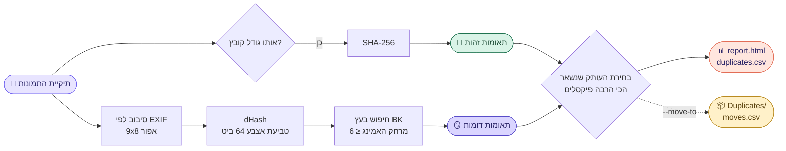
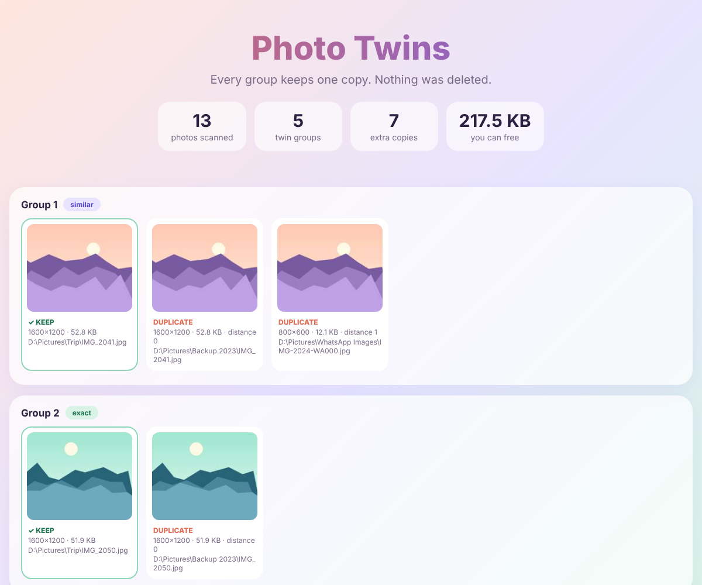

<div dir="rtl">

<p align="center">
  <a href="https://github.com/NoyaAdivi/photo-twins"></a>
</p>

<p align="center"><a href="README.md"></a></p>

<p align="center">
  <a href="#quick-start"></a>
  <a href="#how-it-works"></a>
  <a href="photo_twins.py"></a>
  <a href="https://github.com/NoyaAdivi/sort-photos"></a>
</p>

<p align="center">
  <a href="https://github.com/NoyaAdivi/photo-twins/actions/workflows/tests.yml"></a>
  <a href="LICENSE"></a>
  <a href="https://github.com/NoyaAdivi/photo-twins/commits/main"></a>
  <a href="https://github.com/NoyaAdivi/photo-twins"></a>
</p>

<h3 align="center">אותה תמונה שמורה בחמש תיקיות? מוצאים כל תאומה ומשאירים את הטובה ביותר.</h3>

<p align="center">
  Photo Twins סורק ספריית תמונות גדולה ומוצא <b>כפילויות זהות</b> (קבצים זהים לגמרי) ו<b>כפילויות דומות</b><br>(אותה תמונה אחרי הקטנה, דחיסה מחדש, שליחה בוואטסאפ או חיתוך קל). הוא אף פעם לא מוחק כלום.
</p>

<table align="center">
  <tr>
    <td align="center" width="25%"><a href="#how-it-works"><b>👯 2</b></a><br><sub>סוגי תאומות</sub></td>
    <td align="center" width="25%"><a href="#highlights"><b>🗑️ 0</b></a><br><sub>קבצים שנמחקים</sub></td>
    <td align="center" width="25%"><a href="#undo"><b>↩️ 1</b></a><br><sub>פקודה לביטול</sub></td>
    <td align="center" width="25%"><a href="#how-it-works"><b>🧬 64</b></a><br><sub>ביט טביעת אצבע לתמונה</sub></td>
  </tr>
</table>

<p align="center">
  <a href="#the-report"></a>
</p>

<a name="highlights"></a>
<p align="center"><a href="#how-it-works"></a></p>

<table>
  <tr valign="top">
    <td width="33%"><p><b>🔍 מוצא גם את המוסתרות</b></p><ul><li><b>זהות:</b> קודם גודל קובץ, ואז SHA-256, כך שרק חשודות מקבלות hash</li><li><b>דומות:</b> hash תפיסתי של 64 ביט תופס עותקים מוקטנים, שנשמרו מחדש או נחתכו</li><li><b>מכיר סיבוב:</b> כיוון ה־EXIF מוחל קודם</li></ul></td>
    <td width="33%"><p><b>🛡️ בטוח מהיסוד</b></p><ul><li><b>רק דוח</b> כברירת מחדל, שום דבר לא זז</li><li><b>לא מוחק אף פעם:</b> העותקים העודפים עוברים לתיקייה שתבחרי</li><li><b>ביטול מלא:</b> כל העברה נרשמת ב־<code>moves.csv</code></li></ul></td>
    <td width="33%"><p><b>🏆 משאיר את העותק הטוב</b></p><ul><li><b>הכי הרבה פיקסלים</b> קודם, אחר כך הקובץ הגדול, ואז הישן</li><li><b>דוח ויזואלי</b> עם תמונות ממוזערות של כל קבוצה</li><li><b>מהיר:</b> חיפוש בעץ BK במקום להשוות כל זוג</li></ul></td>
  </tr>
</table>

<a name="how-it-works"></a>
<p align="center"><a href="#the-report"></a></p>



<details open>
<summary><b>🧬 ה־hash התפיסתי, בדקה אחת</b></summary>

כל תמונה מוקטנת ל־9x8 פיקסלים אפורים, וכל פיקסל מושווה לשכן שמימינו: בהיר יותר זה `1`, כהה יותר זה `0`. כך מתקבלת טביעת אצבע של 64 ביט, שכמעט לא משתנה כשמקטינים תמונה, דוחסים אותה מחדש או מוסיפים פילטר עדין. שתי תמונות הן תאומות כשטביעות האצבע שלהן שונות בעד `--distance` ביטים (מרחק האמינג, 6 כברירת מחדל).

השוואה של כל זוג הייתה לוקחת *n²* צעדים (800 מיליון עבור 40,000 תמונות). **עץ BK** משתמש באי־שוויון המשולש כדי לדלג על ענפים שלמים, כך שכל חיפוש נוגע רק בחלק קטן מהספרייה. הקבוצות נבנות סביב העותק הטוב ביותר, כך ש־A דומה ל־B ו־B דומה ל־C לא מתחברים לקבוצה אחת כש־A ו־C שונות.
</details>

<a name="the-report"></a>
<p align="center"><a href="#quick-start"></a></p>

<p align="center">
  <a href="#quick-start"></a>
</p>

<details open>
<summary><b>📁 מה נוצר</b></summary>

<div dir="ltr">

```
twins-report/
├── report.html      open it in any browser: thumbnails, sizes and paths of every group
└── duplicates.csv   one row per file: group, kind, keep/duplicate, size, resolution, distance

Duplicates/          only with --move-to, the original sub-folder structure is kept
└── moves.csv        the undo log
```
</div>

`report.html` נפתח בכל דפדפן ומראה כל קבוצה עם תמונות ממוזערות. `duplicates.csv` מכיל שורה לכל קובץ. התיקייה `Duplicates` נוצרת רק עם `--move-to`, ומבנה התיקיות המקורי נשמר בה.
</details>

<a name="tech-stack"></a>
<p align="center"><a href="#quick-start"></a></p>

<p align="center">
  <a href="https://www.python.org"></a>
  <a href="https://python-pillow.org"></a>
  <a href="https://github.com/bigcat88/pillow_heif"></a>
  <a href="https://docs.pytest.org"></a>
  <a href="https://github.com/features/actions"></a>
</p>

<a name="quick-start"></a>
<p align="center"><a href="#contact"></a></p>

צריך **Python 3.10 ומעלה**. בלי הורדת מודל ובלי כרטיס מסך.

```bash
pip install -r requirements.txt
```

1. **סריקה ודוח** (שום דבר לא זז):
   ```bash
   python photo_twins.py "D:\Pictures" --similar
   ```
2. **פותחים** את `twins-report\report.html` ובודקים את הקבוצות.
3. **מעבירים את העותקים העודפים** לתיקייה נפרדת:
   ```bash
   python photo_twins.py "D:\Pictures" --similar --move-to "D:\Duplicates"
   ```
4. עוברים על `D:\Duplicates`, וכשהכול נראה טוב, מוחקים אותה בעצמך.

<a name="undo"></a>
> [!TIP]
> **התחרטת?** פקודה אחת מחזירה כל קובץ למקום שלו:
> ```bash
> python photo_twins.py --undo "D:\Duplicates\moves.csv"
> ```

> [!NOTE]
> עובד מצוין אחרי [Sort Photos](https://github.com/NoyaAdivi/sort-photos): קודם ממיינים, ואז מריצים את Photo Twins על `Sorted\photos`.

<details>
<summary><b>⚙️ כל האפשרויות</b></summary>

| אפשרות | תיאור |
| --- | --- |
| `--similar` | מוצא גם כפילויות דומות (מוקטנות, שנשמרו מחדש, מסובבות, חתוכות קלות) |
| `--distance N` | מרחק האמינג המקסימלי ל"דומות", 0 עד 64 (ברירת מחדל `6`). נמוך יותר זה מחמיר יותר |
| `--report DIR` | לאן לכתוב את `report.html` ואת `duplicates.csv` (ברירת מחדל `twins-report`) |
| `--move-to DIR` | מעביר לכאן את העותקים העודפים ורושם כל העברה |
| `--undo MOVES_CSV` | מחזיר כל קובץ שרשום ב־`moves.csv` |
| `--max-groups N` | כמה קבוצות יוצגו ב־`report.html` (ברירת מחדל `500`). ב־CSV תמיד יש את כולן |
| `--workers N` | כמה תהליכונים קוראים קבצים (ברירת מחדל: מספר הליבות) |
</details>

<details>
<summary><b>🧪 הרצת הבדיקות</b></summary>

```bash
pip install -r requirements-dev.txt
pytest -q
```
הבדיקות בונות ספריות תמונות קטנות תוך כדי ריצה ובודקות את ה־hash, את עץ ה־BK מול חיפוש מלא, קיבוץ של זהות ודומות, בחירת העותק שנשאר, והעברה וביטול מלאים. הן רצות על Windows ועל Ubuntu ב־[GitHub Actions](.github/workflows/tests.yml).
</details>

<details>
<summary><b>🖼️ פורמטים</b></summary>

JPG, PNG, BMP, WEBP, TIFF, GIF ו־HEIC/HEIF (דרך `pillow-heif`). קבצים שלא נקראים מדולגים ואף פעם לא מועברים.
</details>

<a name="contact"></a>
<p align="center"><a href="https://www.linkedin.com/in/noya-adivi/"></a></p>

<p align="center">
  <a href="https://github.com/NoyaAdivi/photo-twins"></a>
  <a href="https://www.linkedin.com/in/noya-adivi/"></a>
  <a href="https://noyaadivi.github.io/noya-website"></a>
  <a href="https://github.com/NoyaAdivi"></a>
</p>

</div>
