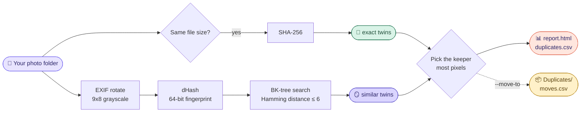
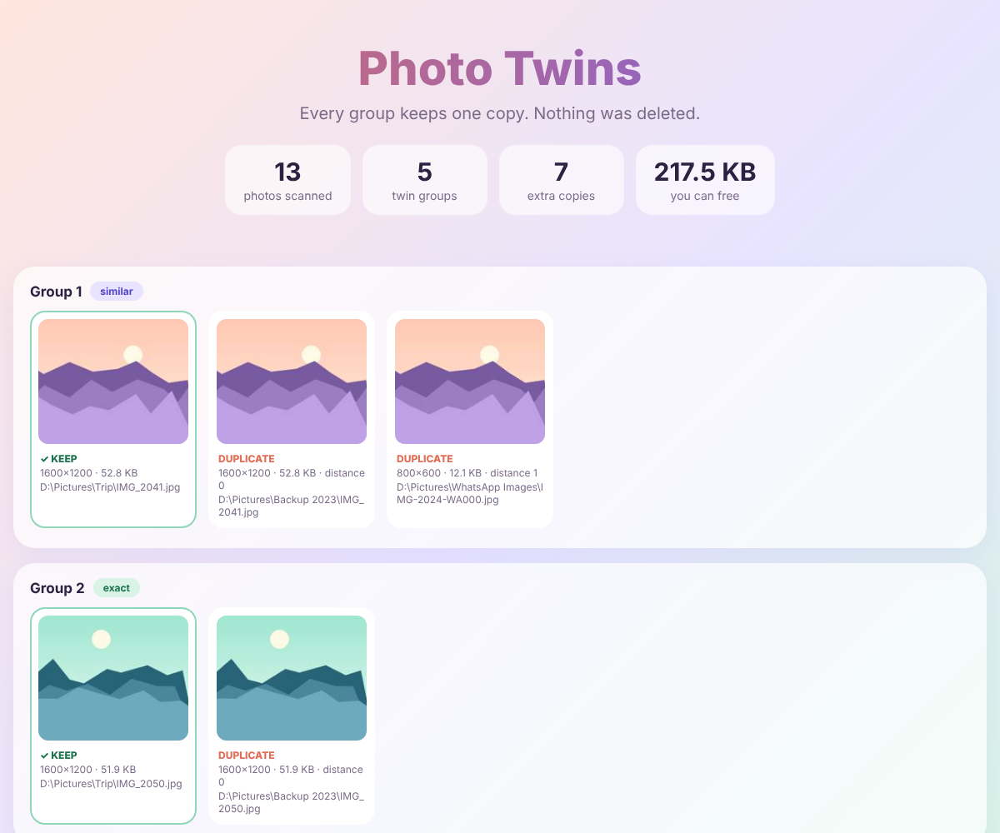

<p align="center">
  <a href="https://github.com/NoyaAdivi/photo-twins"></a>
</p>

<p align="center"><a href="README.he.md"></a></p>

<p align="center">
  <a href="#quick-start"></a>
  <a href="#how-it-works"></a>
  <a href="photo_twins.py"></a>
  <a href="https://github.com/NoyaAdivi/sort-photos"></a>
</p>

<p align="center">
  <a href="https://github.com/NoyaAdivi/photo-twins/actions/workflows/tests.yml"></a>
  <a href="LICENSE"></a>
  <a href="https://github.com/NoyaAdivi/photo-twins/commits/main"></a>
  <a href="https://github.com/NoyaAdivi/photo-twins"></a>
</p>

<h3 align="center">The same photo, saved in five folders? Find every twin and keep the best one.</h3>

<p align="center">
  Photo Twins scans a big photo library and finds <b>exact duplicates</b> (identical files) and <b>similar duplicates</b><br>(the same picture resized, re-compressed, sent over WhatsApp or slightly cropped). It never deletes anything.
</p>

<table align="center">
  <tr>
    <td align="center" width="25%"><a href="#how-it-works"><b>👯 2</b></a><br><sub>kinds of twins</sub></td>
    <td align="center" width="25%"><a href="#highlights"><b>🗑️ 0</b></a><br><sub>files ever deleted</sub></td>
    <td align="center" width="25%"><a href="#undo"><b>↩️ 1</b></a><br><sub>command to undo</sub></td>
    <td align="center" width="25%"><a href="#how-it-works"><b>🧬 64</b></a><br><sub>bit image fingerprint</sub></td>
  </tr>
</table>

<p align="center">
  <a href="#the-report"></a>
</p>

<a name="highlights"></a>
<p align="center"><a href="#how-it-works"></a></p>

<table>
  <tr valign="top">
    <td width="33%"><p><b>🔍 Finds the sneaky ones</b></p><ul><li><b>Exact:</b> same size, then SHA-256, so only real twins are hashed</li><li><b>Similar:</b> a 64-bit perceptual hash catches resized, re-saved and cropped copies</li><li><b>Rotation-aware:</b> EXIF orientation is applied first</li></ul></td>
    <td width="33%"><p><b>🛡️ Safe by design</b></p><ul><li><b>Report only</b> by default, nothing moves</li><li><b>Never deletes:</b> extra copies are moved to a folder you choose</li><li><b>Full undo:</b> every move is logged in <code>moves.csv</code></li></ul></td>
    <td width="33%"><p><b>🏆 Keeps the best copy</b></p><ul><li><b>Most pixels</b> first, then the biggest file, then the oldest</li><li><b>Visual report</b> with thumbnails of every group</li><li><b>Fast:</b> BK-tree search instead of comparing every pair</li></ul></td>
  </tr>
</table>

<a name="how-it-works"></a>
<p align="center"><a href="#the-report"></a></p>



<details open>
<summary><b>🧬 The perceptual hash, in one minute</b></summary>

Each image is shrunk to 9x8 gray pixels, and every pixel is compared with its right neighbor: brighter is `1`, darker is `0`. That gives a 64-bit fingerprint that barely changes when a photo is resized, re-compressed or gets a light filter. Two photos are twins when their fingerprints differ in at most `--distance` bits (the Hamming distance, 6 by default).

Comparing every pair would take *n²* steps (800 million for 40,000 photos). A **BK-tree** uses the triangle inequality to skip whole branches, so each lookup touches only a small part of the library. Groups are built greedily around the best copy, so A~B and B~C never chain into one group when A and C look different.
</details>

<a name="the-report"></a>
<p align="center"><a href="#quick-start"></a></p>

<p align="center">
  <a href="#quick-start"></a>
</p>

<details open>
<summary><b>📁 Output</b></summary>

```
twins-report/
├── report.html      open it in any browser: thumbnails, sizes and paths of every group
└── duplicates.csv   one row per file: group, kind, keep/duplicate, size, resolution, distance

Duplicates/          only with --move-to, the original sub-folder structure is kept
└── moves.csv        the undo log
```
</details>

<a name="tech-stack"></a>
<p align="center"><a href="#quick-start"></a></p>

<p align="center">
  <a href="https://www.python.org"></a>
  <a href="https://python-pillow.org"></a>
  <a href="https://github.com/bigcat88/pillow_heif"></a>
  <a href="https://docs.pytest.org"></a>
  <a href="https://github.com/features/actions"></a>
</p>

<a name="quick-start"></a>
<p align="center"><a href="#contact"></a></p>

Requires **Python 3.10+** ([download](https://www.python.org/downloads/), and tick **Add python.exe to PATH** while installing). No model download, no GPU.

**1. Open a terminal in the project folder**

<table><tr><td>

1. [Download the project](https://github.com/NoyaAdivi/photo-twins/archive/refs/heads/main.zip) and unzip it, or clone it with Git.
2. Open the project folder in File Explorer.
3. Click the address bar at the top, type `cmd` and press **Enter**. A black window opens, already inside the folder.
</td></tr></table>

**2. Install once**

```bash
pip install -r requirements.txt
```

**3. Find your twins** (a report only, nothing moves)

Replace `D:\Pictures` with your own photo folder. Tip: open the folder in File Explorer, click the address bar and copy the path. Keep the quotes.

```bash
python photo_twins.py "D:\Pictures" --similar
```

**4. Look at the report**

A new `twins-report` folder appears in the project folder. Double-click `report.html` inside it, and every group opens in your browser with the copy to keep marked in green.

**5. Move the extra copies** (optional)

```bash
python photo_twins.py "D:\Pictures" --similar --move-to "D:\Duplicates"
```
Look through `D:\Duplicates`. When you are happy, delete it yourself.

> [!TIP]
> Start with a small folder to see how it works. Not sure what a group is? Open the report before moving anything.

<a name="undo"></a>
> [!TIP]
> **Changed your mind?** One command puts every file back where it was:
> ```bash
> python photo_twins.py --undo "D:\Duplicates\moves.csv"
> ```

> [!NOTE]
> Works great after [Sort Photos](https://github.com/NoyaAdivi/sort-photos): sort first, then run Photo Twins on `Sorted\photos`.

<details>
<summary><b>⚙️ All options</b></summary>

| Option | Description |
| --- | --- |
| `--similar` | Also find near-duplicates (resized, re-saved, rotated, lightly cropped) |
| `--distance N` | Max Hamming distance for "similar", 0-64 (default `6`); lower is stricter |
| `--report DIR` | Where to write `report.html` and `duplicates.csv` (default `twins-report`) |
| `--move-to DIR` | Move the extra copies here and log every move |
| `--undo MOVES_CSV` | Put back every file listed in a `moves.csv` |
| `--max-groups N` | Groups shown in `report.html` (default `500`); the CSV always has all of them |
| `--workers N` | Threads for reading files (default: CPU cores) |
</details>

<details>
<summary><b>🧪 Running the tests</b></summary>

```bash
pip install -r requirements-dev.txt
pytest -q
```
The tests build tiny photo libraries on the fly and check the hash, the BK-tree against brute force, exact and similar grouping, the keeper choice and a full move and undo round trip. They run on Windows and Ubuntu with [GitHub Actions](.github/workflows/tests.yml).
</details>

<details>
<summary><b>🖼️ Formats</b></summary>

JPG, PNG, BMP, WEBP, TIFF, GIF and HEIC/HEIF (through `pillow-heif`). Unreadable files are skipped and never moved.
</details>

<a name="contact"></a>
<p align="center"><a href="https://www.linkedin.com/in/noya-adivi/"></a></p>

<p align="center">
  <a href="https://github.com/NoyaAdivi/photo-twins"></a>
  <a href="https://www.linkedin.com/in/noya-adivi/"></a>
  <a href="https://noyaadivi.github.io/noya-website"></a>
  <a href="https://github.com/NoyaAdivi"></a>
</p>
